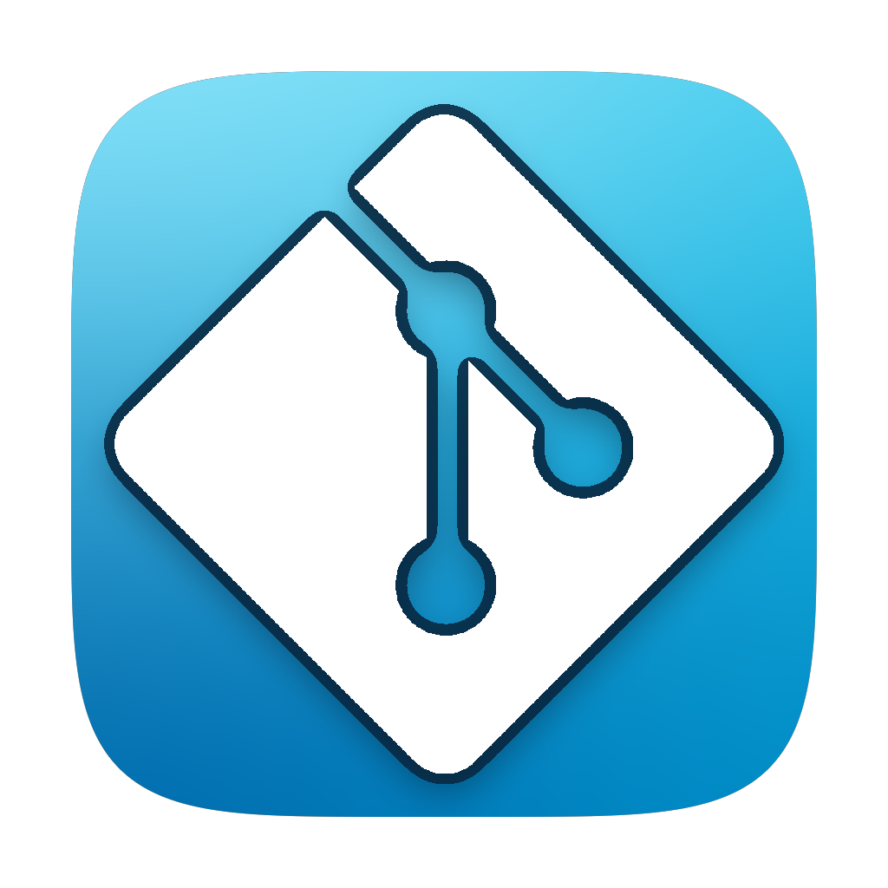

<h1 align="center">gg</h1>

<p align="center">
  
</p>

<h3 align="center">
  <div>
    <a href="https://github.com/karolsko/gg/issues">
        
    </a>
    <a href="https://github.com/karolsko/gg/stargazers">
        
    </a>
    <a href="https://github.com/karolsko/gg/actions/workflows/release.yml">
        
    </a>
    <a href="https://github.com/karolsko/gg">
        
    </a>
    <a href="https://github.com/karolsko/gg/blob/main/LICENSE">
        
    </a>
    <br>
    </div>
</h3>

> A fast Git client

**gg** is a desktop Git client. The window is native UI drawn by [MyGo](https://mygo.egoist.dev). Repository operations go through the `git` installed on your machine, so your SSH keys, credential helper, hooks, and config stay in use.

## 🧰 Features

- a sidebar of repositories you have opened, cloned, or created
- working tree changes: stage, unstage, discard, and commit
- commit history with a branch graph
- split and unified diffs, with syntax highlighting
- local branches, remotes, tags, and stashes
- fetch, pull, push, checkout, merge, and delete a merged branch
- the list of repositories is kept between launches

Interactive rebase, staging individual lines, image diffs, blame, and Git LFS are not in this version.

## 📋 Requirements

- Go `1.27.3` or newer, to build
- `git`

## 🛠️ Installation

### 📦 Binary Releases

Pre-compiled binaries for Linux, Windows, and macOS are available on the [Releases](https://github.com/karolsko/gg/releases) page.

### 🐹 Using Go

You can install `gg` directly using `go install`:

```bash
go install github.com/karolsko/gg@latest
```

### 🏗️ Build from Source

To build from source, you need to have [Go](https://go.dev/) installed.

```bash
git clone https://github.com/karolsko/gg.git
cd gg
go build -o gg .
```

## 📖 Usage

Launch `gg`. Open a repository, clone one, or create a new one. Each repository you open is added to the list on the left. Click a name to switch. Remove an entry from the list with the right-click menu. That does not delete the files.

Drop a folder on the window to open the repository that contains it.

The changes view lists unstaged and staged files. Select a file to read its diff. Commit with the button, or with `⌘↩` on macOS and `Ctrl+Enter` elsewhere.

The history view shows the graph for the selected branch, tag, or all commits. Select a commit, then a file, to read that change.

| Action          | macOS | Windows and Linux |
| --------------- | ----- | ----------------- |
| Open repository | `⌘O`  | `Ctrl+O`          |
| Clone           | `⇧⌘N` | `Ctrl+Shift+N`    |
| Fetch           | `⇧⌘F` | `Ctrl+Shift+F`    |
| Pull            | `⇧⌘L` | `Ctrl+Shift+L`    |
| Push            | `⇧⌘P` | `Ctrl+Shift+P`    |
| Stash           | `⇧⌘S` | `Ctrl+Shift+S`    |
| Refresh         | `⌘R`  | `Ctrl+R`          |
| Commit          | `⌘↩`  | `Ctrl+Enter`      |

A branch with no upstream is published with `git push -u` to `origin`, or to the first remote when `origin` is missing.

## 👨🏻‍💻 Development

1. **Clone the repository**

   ```sh
   git clone https://github.com/karolsko/gg.git
   cd gg
   ```

1. **Run the tests**

   ```sh
   go test ./...
   ```

1. **Run the app**

   ```sh
   go tool mygo dev
   ```

## 📜 License

This project is licensed under the **MIT License**. See the [LICENSE](LICENSE) file for details.
